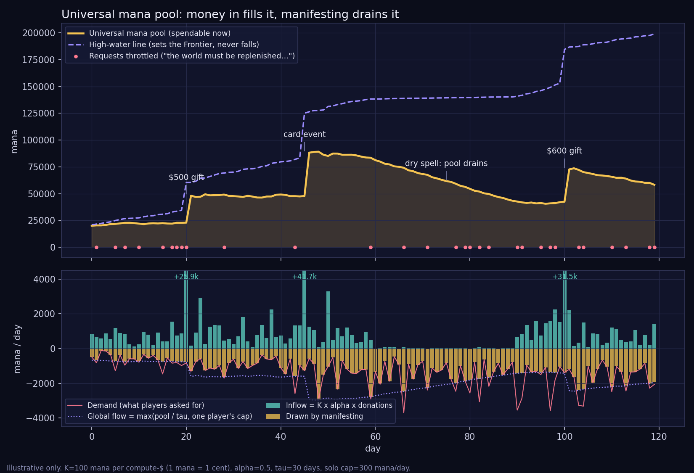
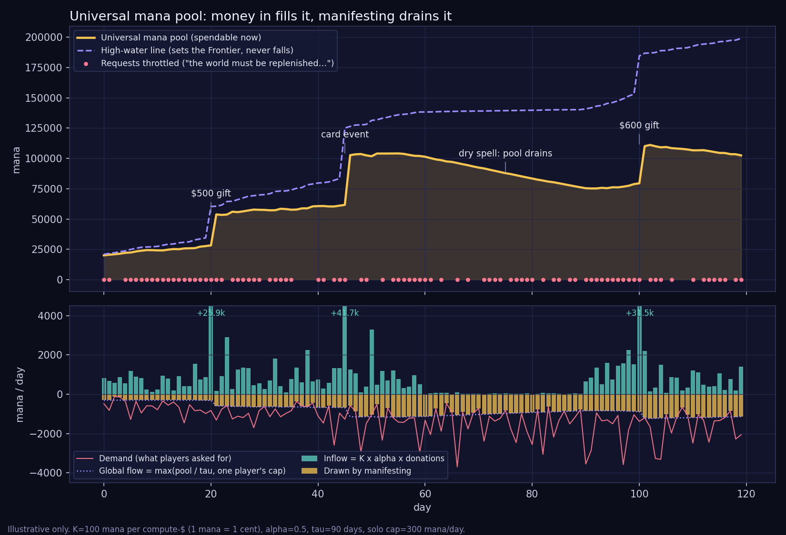

# Phase 05: Mana Economy & Donations

**Status:** `[ ]` Not Started (design ~settled 2026-10-13; see [The Mana Pool Formula](#the-mana-pool-formula))
**Depends on:** [Phase 02: Multiplayer Core](./02-multiplayer-core.md), [Phase 04: Navigation & Controls](./04-navigation-controls.md)
**ROADMAP reference:** [The Mana Mechanic: The Frontier of Dreams](../ROADMAP.md#the-mana-mechanic-the-frontier-of-dreams) (rewritten for the October model 2026-10-14)
**Estimated sessions:** 4-5

## Goal

Implement the mana economy. **Mana is the universe's creative energy, and it is literally compute:** one universal pool, filled by donations, drained when players manifest things with Gen AI. Nobody holds mana. Giving swells the pool for everyone; the more there is, the faster the whole universe can create. Separately, the **high-water line** (everything that has ever flowed in, plus the reach of awe) sets the **Living Frontier**, and Ghost worlds solidify when the Frontier reaches them. The **solidification wave** (a golden shockwave sweeping outward when someone donates) is the defining visual moment of Aweborn.

**Awe is about growth, not energy:** exploring and the reactions others have to what you made earn **experience → levels** (which unlock abilities) and push the high-water line outward. Awe never mints spendable mana.

**Key deviation from the original ROADMAP (2026-10-13):** the August model (awe as the primary mana source, natural regeneration, donation afterglow, per-player flow rate with diminishing returns, fixed game-design costs, targeted patronage) is retired. The October model is below. Gen AI cost research lives in [Phase 07](./07-genai-creation.md).

## Architecture Decisions

| Decision | Choice | Rationale |
|----------|--------|-----------|
| Mana authority | **Server-authoritative** for manifesting (solid worlds, AI generation). **Dreaming stays free, manifesting draws on the universal pool** (Alex, 2026-10-13): ghost/offline creation needs no mana and no validation | Prevents cheating while allowing unlimited offline creativity |
| Who holds mana | **Nobody. Players hold no mana at all** (Alex, 2026-10-13 evening). There is one **universal pool**; giving to the mission swells it. *Supersedes the morning's personal reserve, mana purchases, creator earnings and the Curiosity Budget.* | Every gift is a pure gift: no personal benefit, so no purchase-vs-donation or unrelated-business-income problem |
| What mana is | **Mana = compute.** 1 mana = $0.01 of real compute (**`K = 100`** mana per compute-dollar; Alex, 2026-10-14). A manifestation costs exactly what it costs us, converted at `K`. No markup | The pool is honestly "how much imagination the donors have paid for" |
| Pool | **The pool is the treasury** (Alex, 2026-10-14, option a): **all money entering the system counts**, at `K`: gifts, card sales, grants, the founding gift. **Every dollar out is a categorized draw**: creations, servers & infra, cards (production + shipping), people (salaries), research, fundraising. So mana is a **live representation of how much money Aweborn has**. *Supersedes "each gift adds `K · α · amount`" (2026-10-13 night).* See [formula](#the-mana-pool-formula) | Radical transparency for a non-profit; one number tells the truth |
| Creative share | **Players draw only from the creative share** `C` (Alex, 2026-10-14): `α` of each unrestricted inflow (card sales count after their own production + shipping; restricted grants add 0). `C ≤ pool` always. Creations can't spend salary money, and salaries can't spend creative money (if a non-creative bill can't be covered by the rest of the pool, **the creative share shrinks to cover it, disclosed**: Alex, 2026-10-14; see Budget shortfall) | Keeps the guarantee "compute ≤ α × income" inside the treasury model |
| Creative fraction `α` | **`α = 0.5`** (2026-10-14, from research: see [Why α = 0.5 and τ = 30 days](#why-α--05-and-τ--30-days)). Half of each net gift becomes mana; draft split of the rest: 20% research, 30% operations + fundraising. Board revisits yearly; may rise toward 1 if a founding grant covers operations | Not every donated dollar can be compute |
| Flow rate | **The universe's flow rate rises for everyone as the pool grows** (Alex, 2026-10-13 evening). Global flow `G = max(pool / τ, p_solo)` per window, **`τ = 30 days`** (chosen by simulation, 2026-10-14). `G` is split **max-min fairly among players active in the last 30 minutes** (Alex: one player alone gets the whole pool at their own cap; with 1,000 players the global flow binds before personal caps) | Compute spend can never outrun what donors give; the pool can't be drained in an afternoon |
| Personal caps | **Per-player cap per window, tunable during play**: `p_i = base(level) × solar` with solar ∈ [0.9, 1.1]. Fairness under scarcity, not a paywall: when the pool is healthy the caps are generous (Alex, 2026-10-13 night). **Values approved 2026-10-16 (Alex: "perfect")**, per rolling 24 h: chapters 1–4 **0**, chapter 5 **150**, chapters 6–7 **250**, after warp **+25 per level up to 1,000**; **`p_solo = 400`** ([MANA_COSTS.md](../MANA_COSTS.md#proposed-personal-caps-baselevel-p_solo)) | "Unlimited imagination" for everyone, shared fairly when energy is low |
| Admission & order | **Requests are ordered; each asks "how much compute does this take?"** If it exceeds what the pool (and caps) allow → no-dice and the universe whispers *the world must be replenished*. **Priority order, formula deferred** (Alex, 2026-10-13 night). Reserve the estimate, settle the actual, refund on failure | No literal simultaneity; a queue with a gentle denial |
| Mana cost model | **Priced by complexity, driven by real costs** (Alex, 2026-10-13). Place/move: tiny; meshes/terrain/sound: a lot; a whole new world: a lot more. Abstracted by output, not provider | Mana stays honest about what reality costs |
| Cost abstraction | **Not tied to specific AI model/provider**: based on output metrics (complexity, duration, resolution) | Allows provider swaps without economy changes |
| Experience & levels | **Levels unlock abilities** (e.g. warp, creating a sound): a scaffolded, studio-like path through every Gen AI tool (Alex, 2026-10-13 evening). **Q16 (Alex, 2026-10-14): a level measures a mix of mana successfully channeled into creations and breadth of skills** along the creator's journey. Plus XP from reactions (others' awe at what you made) and your own awe (2026-10-13). Channeled-mana XP uses concave scaling and counts only creations that settle and stay, so burning the shared pool isn't a shortcut. **Warp gated behind a level** (Q14 b). Card taps / `/w/<uuid>` links always deliver a player inside the world | Rewards real creating and learning every tool; manifesting stays open to all |
| Unlock ladder | **Warp comes last** (Alex, 2026-10-14). Order: move → steer → drive/neutral → enter a world → place objects → the other maker tutorials → **mastery of your immediately accessible space + enough exploration of the universe** → warp. "Warp only goes to players who have mastered their local space" | You learn the universe by moving through it; warp is a reward for knowing it, not a shortcut past it |
| Seed grant | **Alex makes the founding gift** (2026-10-14) that seeds the pool before the first players arrive; **$1,000** (Alex, 2026-10-14; 5× the simulation's $200 floor). At the standard split that is ~50,000 mana; whether the founding gift goes 100% to the pool (~100,000 mana) is open. Cloud bills already paid personally: ~$1K (in-kind vs reimbursement → CPA, business plan v0.4 §9) | Without a seed the first players hit the cap constantly |
| Three numbers | **High-water line** = all mana that has ever come in + awe reach (sets the Frontier, never falls); **Pool** = the treasury now; **Creative share** = what players can create with now (2026-10-14; was two numbers on 2026-10-13) | Spending never shrinks reality; the pool is honest; the creative share is fair |
| Awe | **Awe gives experience *and* raises the high-water line** (Alex, 2026-10-13 evening, Q13 a). Only donations fill the pool / raise the flow | Curiosity is rewarded without minting spendable mana |
| Patronage | **Scrapped** (Alex, 2026-10-13 night): no targeted solidification, no Oasis, no print-your-world patronage | Donations buy no personal advantage; the Frontier belongs to everyone |
| Donor perks | **Close to zero: opt-in name in the golden wave** (confirmed by Alex, 2026-10-14; replaces Aug 19 "cosmetics only") | Pure gifts, with a nice touch |
| Organization | **Aweborn is a non-profit, already incorporated with 501(c)(3) status** (Alex, 2026-10-13). Mission: MatchRank research, systematically building teams with psychological safety (see [RESEARCH.md](../RESEARCH.md)). No equity investors; backers are donors, grant makers, impact funders, research partners | Mission first |
| Glow | **Aura brightness scales with mana channeled recently**, no rank or status (Alex, 2026-10-13, Q9 b) | Rewards manifesting, not hoarding |
| Donation pipeline | Existing Stripe → Lambda → mana pool (extend current Lambda) | Reuses proven payment flow |
| Frontier shape | Sector-based (not perfect sphere) | Allows organic expansion bulges |
| Mana → radius | `r ∝ ∛(high-water line)` (confirmed 2026-10-13, Alex, Q10 a) | Early gifts have dramatic effect; each mana adds equal volume |
| Frontier scale | **`c = ∛10 ≈ 2.154`** (Alex, 2026-10-14 evening, option A "tight"): `r = 100 u · ∛($ ever in / $1,000)`. Founding gift → 100 u around Origin (the sighting bubble), $10k → 215 u, $100k → 464 u, **$1M → 1,000 u (one sector)** | Reality is scarce early: most worlds stay Ghost for a long time, so every expansion means something |
| Wave size | **Same size for every gift** (Alex, 2026-10-14 evening): pure celebration, not to scale. The edge itself moves by the true amount (often a fraction of a unit) | A $10 gift feels as loved as a big one; the honest number lives in the Frontier, not the wave |
| Solar cycle | **Both** (Alex, 2026-10-14): visual day/night mood **and** a small modifier on personal caps, 1.1× at solar noon to 0.9× at midnight, sinusoidal | Healthy rhythms without a personal flow rate |
| Draw validation | sync-service validates all mana draws (solidified-world actions + AI generation) | In-memory state makes validation fast |
| Creation model | **Online = AI prompt (draws mana), Offline = edit/arrange (free)** | AI calls need network; editing is local-only |

## The Mana Pool Formula

> v3 (2026-10-14, Alex): **the pool is the treasury**: all money in, every categorized draw out; players draw only from the creative share. v2 (2026-10-14): `K = 100`, `α = 0.5`, `τ = 30 days`, max-min fair split among active players, solar ±10% on personal caps. v1 (2026-10-13 night) was written from Alex's description: *money in → mana pools up → players manifest → pool drains a little*.

```text
Constants (tunable, public)
  K      = 100 mana per dollar                1 mana = $0.01
  α      = 0.5   creative fraction of each unrestricted inflow   (see "Why α = 0.5")
  τ      = 30 days   drain horizon of the creative share          (see "Why τ = 30 days")

Money in: every source (gifts, card sales, grants, founding gift), net of processor fees
  m          = K · net_amount                 $10 gift ≈ $9.41 net → ≈ 941 mana
  pool      += m                              the treasury, live
  highWater += m                              never falls
  creative  += α · m'                         m' = m for gifts; card sales after their own production + shipping;
                                              restricted grants: 0 (tracked against their purpose)
                                              $10 gift → ≈ 470 creative mana

Money out: every draw has a category
  creations · servers & infra · cards · people · research · fundraising · other
  pool      -= K · amount
  creations only:  creative -= actual         players never draw on any other category
  invariant: 0 ≤ creative ≤ pool              a non-creative draw that would break it → shortfall:
    creative = pool (shrinks by the gap), ledger + public star "creative share covered $X of <category>"
    disclosed in advance on giving.html + Terms (2026-10-14); later gifts refill creative as usual (α · m')

When awe happens
  highWater += reach(awe)                     never touches pool or creative
  xp[player] += xp(awe)

Flow, per window (e.g. per minute), on the creative share only
  G    = min(creative, max(creative / τ, p_solo))   never below one player's cap
  N    = distinct players active in the last 30 minutes
  p_i  = base(level_i) × solar_i              personal cap, solar_i ∈ [0.9, 1.1]
  flow_i = max-min fair share of G among the N players, capped at p_i
           (one player alone → p_i; 1,000 players → ≈ G / N each, unused share redistributed)

When a player asks to manifest r (requests are processed in priority order; formula later)
  est = estimate(r)                           real compute cost × K
  admit if   est ≤ creative − reserved   and   est fits flow_i this window
  admit  → reserved += est → generate → creative −= actual, pool −= actual, reserved −= est
           (failure → nothing drawn)
  reject → whisper: "The world must be replenished…"   (gentle, not punitive)

Display
  pool shown smoothed (e.g. 30-day average) so payday reads as a calm breath, not a crash

Frontier
  frontierRadius = c · ∛(highWater)           c = ∛10 ≈ 2.154  (2026-10-14, tight)
                 = 100 u · ∛(dollars ever in / 1,000)
                 $1k → 100 u · $10k → 215 u · $100k → 464 u · $1M → 1,000 u · $10M → 2,154 u
                 8× the money = 2× the radius; awe reach adds to highWater in mana units
```





*Charts predate v3: the gold line there is today's creative share. Illustrative only, made-up numbers. Regenerate with `python3 phases/assets/mana_pool_chart.py` (and `… 90` for the comparison). Top: the pool (gold) jumps with gifts and drains while people manifest; the high-water line (violet) only rises. Bottom: daily inflow vs mana drawn, players' demand, and the global flow. The per-player fair split isn't simulated.*

**What the charts show:**

1. **Linear and direct.** Every dollar adds the same mana; every manifestation subtracts its real cost. Nothing else (no regen, no afterglow) touches the pool.
2. **Flow rises with gifts automatically**, because `G` is a share of the pool. A busy afternoon can't drain months of gifts.
3. **`τ` is a balance.** At 90 days the pool keeps growing while players are told to wait almost every day (donors' money sitting idle). At 30 days, players are throttled only on spikes and the dry spell (days 60–90) drains gently.
4. **The early days need a seed.** The simulation starts with a $200 seed grant (20,000 mana); without one, the first players hit the cap constantly. **Alex's founding gift: $1,000** (2026-10-14).
5. **Mana = compute, so no markup.** The non-profit's costs come from `1 − α`, not from overcharging mana.
6. **Reserve, then settle.** Gen AI cost is only known afterwards; failures cost nothing.

### Why α = 0.5 and τ = 30 days

**`α` (creative share) = 0.5.** Mana is one of two *program* activities: the compute that lets everyone create, and the MatchRank research the game exists for ([RESEARCH.md](../RESEARCH.md)). The other half of each gift pays for research, people, operations and fundraising. Draft split: **50% mana · 20% research · 30% operations + fundraising.**

- **Program share ≥ 65%.** The BBB Wise Giving Alliance's Standard 8 asks a charity to spend at least 65% of total expenses on program activities, and Standard 9 caps fundraising at 35% of related contributions ([BBB Standards for Charity Accountability](https://give.org/charity-reviews/bbb-standards-for-charity-accountability)). Mana (50%) + research (20%) = 70% program.
- **Don't push `α` toward 1 by starving the organization.** Gregory & Howard describe the "nonprofit starvation cycle": funders' unrealistic overhead expectations lead nonprofits to underinvest in the infrastructure they need ([Stanford Social Innovation Review, 2009](https://ssir.org/articles/entry/the_nonprofit_starvation_cycle)). Half for compute leaves room to pay people and build the research properly.
- **Donors are overhead-averse, so make the number simple and honest.** In lab and field experiments, telling potential donors that overhead was already covered by another funder increased giving ([Gneezy, Keenan & Gneezy, *Science* 2014, "Avoiding overhead aversion in charity"](https://doi.org/10.1126/science.1253932)). Implication: one clear sentence ("half of every gift becomes mana for everyone") and, if a founding grant ever covers operations, raise `α` for individual gifts toward 1.
- **Show impact, not just the ratio.** People overweight overhead ratios when judging a single charity in isolation, because a ratio is easy to evaluate and impact is not ([Caviola et al., *Judgment and Decision Making* 2014](https://www.ncbi.nlm.nih.gov/pmc/articles/PMC4179876/)). The golden wave and the pool ambience *are* the impact display.

**`τ` (drain horizon) = 30 days.** No research sets this number; it was **chosen by simulation** (charts above). It is *not* an operating reserve: the nonprofit's reserve (commonly a 3-month minimum, per the Nonprofit Operating Reserves Initiative workgroup's guidance) belongs to the `1 − α` side. The mana pool is meant to be *spent* on creating, so `τ` only stops bursts from draining it.

**`N` over the last 30 minutes (Alex's idea, refined).** `N` decides **how the flow is split**, and `τ` decides **how much flows**. If `τ` itself shrank as players arrived, a crowd would drain the pool fastest exactly when it's busiest; if it grew, a lone player would be starved. Splitting a fixed `G` max-min fairly (a standard fairness rule in network flow allocation: everyone gets at least an equal share, and anything unused goes to those who want more) gives Alex's two cases: one player alone gets their full personal cap, and with 1,000 players the global flow binds before personal caps do. *Open to discuss.*

**Where these citations belong.** Not in Terms or Privacy: those are legal agreements, and Terms only state the fact ("every donation becomes mana in the pool; half is the creative share; the rest funds research and operations"). The public **[Where your gift goes](../public/giving.html)** page (live 2026-10-14) shows the split and these references.

**Open:** window size, the priority formula, and whether players see the pool and caps as numbers or only as ambience. *(`base(level)` / `p_solo` approved 2026-10-16; the window is rolling 24 h in the implementation.)*

## Tasks

### Universal Mana Pool & Ledger
- `[x]` Extend the existing `ManaState` in `shared/crdt-schema.ts` (don't redefine) to the October model (2026-10-16: as below + `shortfall`, `params.c`; `MANA_PARAMS` + `frontierRadiusFor()` exported):
  ```typescript
  interface ManaState {
    pool: number;          // the treasury now (mana; all money in − all draws out)
    creative: number;      // creative share players can draw now (≤ pool)
    reserved: number;      // estimates held for in-flight manifestations
    highWater: number;     // Σ inflow + Σ awe reach; never falls; sets the Frontier
    frontierRadius: number;
    totalIn: number;       // lifetime mana in, all sources
    drawnBy: { program: number; management: number; fundraising: number };   // Form 990 functions
    drawnByPurpose: Record<'creations' | 'research' | 'cards' | 'servers' | 'compensation' | 'other', number>;
    params: { K: number; alpha: number; tauDays: number };   // 100, 0.5, 30
    lastDonationAt: number;
  }
  ```
- `[x]` Append-only ledger on the VPS (SQLite) (2026-10-16: [`mana.ts`](../server/sync-service/src/mana.ts) table `mana_ledger`, integer milli-mana, UPDATE/DELETE blocked by triggers, idempotent on `(kind, ref)`, totals replayed on boot; 17 tests in `mana.test.ts`): every inflow (source, restricted?) and every draw (category), reservations, settlements, refunds, awe reach. Non-player draws (salaries, servers, cards) are entered by an admin tool or imported from statements (Stripe, AWS Cost Explorer, provider invoices). The CRDT shows totals; the ledger is the audit trail
- `[x]` Server writes mana state to the Universe CRDT (authoritative); clients read it reactively. **Also closed a hole:** the server used to apply any client `universe-update` (clients never send one), so anyone could have forged the mana map or worlds; now refused
- `[x]` HTTP: public `GET /mana` + `GET /mana/ledger` (no donors, players or refs: the transparency feed for shooting stars / giving page); admin `POST /api/mana/inflow` + `/draw` behind `MANA_ADMIN_TOKEN` (optional k8s secret, `set-secret.sh generate MANA_ADMIN_TOKEN`; missing = 503)
- `[x]` Record the founding gift ($1,000, `source: founding`) once the token is on the VPS (Alex, 2026-10-16: ledger id 1, ref `founding-2026`; prod pool 100,000 / creative 50,000 / Frontier 100 u)

### Flow & Admission (server)
- `[x]` `requestDraw(player, estimate)` → admit / reject per [the formula](#the-mana-pool-formula) (2026-10-16: [`admission.ts`](../server/sync-service/src/admission.ts) `ManaAdmission`, owned by the RoomManager; 13 tests in `admission.test.ts`)
- `[x]` Global flow per rolling 24 h `G = min(creative, max(creative / τ, p_solo))`; personal cap `p_i = base(progress) × solar` (`MANA_CAPS` + `baseCap()` in `shared/crdt-schema.ts`; solar clamped to [0.9, 1.1])
- `[x]` Active players = seen in the last 30 minutes (connect + every message); what's left of `G` today is split max-min fairly (water-filling) over each active player's remaining headroom. Other players are assumed at the explorer cap (250) since the server doesn't know their progress yet
- `[~]` Priority hook `priority(request)` returns 0. No queue yet: admission is synchronous on one thread, so nothing waits; add the queue when requests do
- `[x]` Reserve → settle actual → release on failure, atomically with the ledger. Rolling spend = settled actual, or the estimate while in flight, or 0 if released
- `[x]` Gentle denial: *"The world must be replenished…"* (reasons: `personal_cap`, `universe_flow`, `insufficient_creative`; chapters 1–4 get "Making things comes a little later on your path.") + `remainingToday`
- `[ ]` HTTP for genai-service (`POST /api/mana/request`, `/settle`, `/release`, service token): add with the genai-service
- `[ ]` Player progress (chapter, warp, levels) from the server instead of the caller, once levels exist
- `[ ]` Ghost creation requires **no validation** (free, unlimited)

### Donation → Mana Pipeline (Extend Lambda)
- `[ ]` On `payment_intent.succeeded`: `m = K · net_amount` → pool + highWater; `α · m` → creative; ledger (via VPS API). Card orders: full net → pool, creative only after production + shipping
- `[ ]` VPS recalculates `frontierRadius`, broadcasts the expansion, triggers the solidification wave for everyone online
- `[ ]` Opt-in donor recognition in the wave ("A wave of light from ★ name" or "a generous soul"). No other donor perks
- `[ ]` Product-agnostic so [Phase 08](./08-nfc-trading-cards.md) card-order surplus flows in as ordinary gifts
- `[-]` ~~`donationMultiplier` 24 h afterglow~~ retired: the flow follows the pool automatically

### Living Frontier & Solidification
- `[ ]` Server calculates `frontierRadius = c · ∛(highWater)`, `c = ∛10` (replaces the placeholder `frontierRadius = 5000` in `server/sync-service/src/universe.ts`)
- `[ ]` Sector-level solidification tracking
- `[ ]` Ghost → Solid transition when the Frontier reaches a world (`solidified: true`, `solidifiedAt`; physics + collision on)
- `[-]` ~~Targeted patronage (5,000 mana) and Oasis~~ scrapped 2026-10-13 (Alex)

### Solidification Wave (The Golden Moment)
- `[ ]` Create `src/effects/SolidificationWave.tsx`
- `[ ]` Golden, translucent shockwave shader (refraction effect)
- `[ ]` Ripples outward from Aweborn Portal at origin; **same size for every gift** (celebration, not to scale; the Frontier edge moves by the true amount separately)
- `[ ]` As wave hits Ghost worlds: wireframes shatter → reform as solid objects
- `[ ]` Audio: deep bass sweep → warm orchestral hum

### Awe → Experience + Reach
- `[ ]` Create `src/systems/AweTracker.ts` (client) and wire the stubbed server hook `server/sync-service/src/awe.ts` (`onFirstDiscovery`, `onAwe`)
- `[ ]` Awe events (first world visit, first creation seen, distance milestone, slingshot chain, cluster discovery, long-absence return) grant **XP** and **high-water reach**, never pool mana. Amounts TBD with the levels design
- `[ ]` **Reactions:** other players' awe at a world credits XP to its creator(s): the main XP source for makers
- `[ ]` Shared-awe 2× when near other players; diminishing novelty on revisits
- `[ ]` Server validates (cheap checks now, [Phase 09](./09-authoritative-flight.md) server-derived later)

### Experience & Levels
- `[x]` Decide what a level measures → **mix of mana channeled into creations + breadth of skills** (Alex, 2026-10-14)
- `[ ]` XP curve: concave per creation and per day for channeled mana; **usage is enough** (Alex, 2026-10-14: no "still standing after N hours" rule)
- `[ ]` Skill list (move, place, terrain, mesh, texture, sound, music, voice, world…) and the breadth gate (level *n* needs *k* distinct skills)
- `[x]` Unlock ladder order → **warp last** (Alex, 2026-10-14). Draft chapters:
  1. **First light:** move, steer
  2. **Pilot:** drive / neutral mode, brake, approach and orbit a world
  3. **Visitor:** enter and leave a world
  4. **Builder:** place, move and arrange objects (free)
  5. **Maker:** one tutorial per tool: texture, sound, music, mesh, terrain, character, create a world
  6. **Local mastery + explorer:** every skill above used in your immediately accessible space, *and* enough of the universe explored (visit *N* worlds, sight *M*, distance milestones)
  7. **Warp unlocked:** K-warp and the World Index "Warp here" button
  Beyond warp, levels keep coming from channeled mana + reactions + breadth
- `[x]` Thresholds for chapter 6 (Alex, 2026-10-14 evening; fixed numbers, because the Frontier is the beginner's acclimation space):
  - **Mastered a skill** = used it successfully 3 times (usage alone; nothing has to survive)
  - **Local space = inside the Frontier**
  - **Visit `N = 10` worlds, sight `M = 30`**
  - **Distance:** 5,000 u flown in total, plus one flight ≥ 1,000 u from Origin, made possible by the **loosened leash** below (Alex, 2026-10-14, option b)
  - **Safety valve:** `N = min(10, worlds inside the Frontier)`, `M = min(30, …)`, so a sparse universe never locks anyone out
- `[ ]` **Beginner cradle:** until warp unlocks, a soft leash keeps the player near a beginner baseline inside the Frontier and gently turns them back if they stray too far (lots of controls, and it's 3D: cradle them in). Arrivals by card or `/w/` link are never yanked back
  - **Chapters 1–5:** leash = the Frontier
  - **Chapter 6, "off the leash" (option b):** the leash widens to `max(1,500 u, Frontier + 500 u)` from Origin (proposal; tune in playtests), so the ≥ 1,000 u flight is a first supervised trip into the Ghost dark. A coming-of-age moment that shows what warp will be for
  - **Chapter 7 (warp):** leash removed
- `[ ]` Map chapters 1–4 onto the existing tutorial steps; chapter 5 needs `base(level)` > 0 for each tool
- `[ ]` Gate the live K-warp and World Index "Warp here" button behind chapter 7 (link/card arrival never gated)

### Budget Shortfall (disclosed shrink)
- `[x]` Behavior decided (Alex, 2026-10-14): bills always get paid; when a non-creative draw exceeds `pool − creative`, the **creative share shrinks by the gap**, in the open. No hidden clip, no loan bookkeeping
- `[x]` Disclosed in advance: giving page ("If money ever runs short") + one Terms sentence (2026-10-14)
- `[ ]` Ledger entry `kind: shortfall` (amount, category covered) + its own shooting star (tap: "the creative share covered $X of servers / compensation …")
- `[ ]` Early warning, **private only** (2026-10-16): runway = (pool − creative) ÷ avg monthly overhead; < 90 days → email Alex. **No in-game decay** (Alex worried it would happen constantly early on; agreed: players can't fix it and a dim world reads as dying). The disclosed shortfall star stays, kept small and calm

### Solar Cycle
- `[ ]` Create `src/systems/SolarCycle.ts`: local solar position from browser timezone (+ sunrise/sunset)
- `[ ]` Visual: warmer/vivid by day, cooler/deeper at night
- `[ ]` Personal-cap modifier 0.9–1.1×, sinusoidal (client reports timezone; server clamps to the range)

### Mana Costs
- `[x]` Cost of each manifestation = real compute cost × `K`: **[MANA_COSTS.md](../MANA_COSTS.md)** (2026-10-14, list prices; full object 60, quick object 30, image 7, 30 s music 6, Maker tutorials ≈ 102, a whole new world ≈ 368)
- `[ ]` Non-compute actions (place/move/arrange): nominal or free; decide with the cost table
- `[-]` ~~Old ROADMAP fixed costs (gravity 500, avatar trail 50, …)~~ retired

### Mana Visualization
- `[ ]` Pool level affects universe ambience:
  - High (>80%): bright stars, rich nebulae, ambient particles
  - Medium (30-80%): baseline
  - Low (<30%): dim, sparse, desaturated
  - Critical (<5%): near-dark, aurora near Portal
  - *(open: "%" of what? e.g. pool relative to 30 days of typical draw)*
  - **Flag (2026-10-16):** same trap as the runway warning: early on the pool is small, so this would make the universe look dim most of the time. Proposal: drive ambience from the **creative flow vs recent demand** ("can everyone create right now?"), never the raw treasury
- `[ ]` Audio ambience scales with pool level
- `[ ]` Drawing mana → satisfying sound (universe breathing through you)

### Shooting Stars: Every Draw Is Visible (Alex, 2026-10-14 evening)
> "Categorize every output, like shooting stars leaving the universe to compute." Radical transparency made beautiful: **every mana that leaves the pool leaves as a shooting star**, colored by its category. Money coming in swells the universe; money going out streaks away.

**Categories follow real non-profit accounting** (Alex, 2026-10-14: "something financially relevant, to get people into finance by tracking the stars"). US non-profits report every expense two ways: by **function** (what it was for) and by **nature** (what it was). That's the IRS Form 990 Part IX *Statement of Functional Expenses* ([Form 990 + instructions](https://www.irs.gov/forms-pubs/about-form-990)), and FASB's ASU 2016-14 asks the same of non-profit financial statements. The stars use both:

- **Color = function**, the three Form 990 columns. Watching gold vs blue vs silver *is* watching the classic non-profit health ratio (program share, cf. the BBB 65% standard on the giving page).
- **Motion = what it did** in the game.
- **Tap → nature**, the Form 990 line (e.g. *Information technology*, *Salaries and wages*, *Fees for services*).

| Function (color) | Draws | Motion | Leaves from | Cadence |
|---|---|---|---|---|
| **Program services** (gold) | **Creations** (the creative share) | Rises out past the Frontier "to the forge"; the creation materializes as it returns | The world being made | Real time, one star per settled manifestation |
| | **Research** | A slow star toward a research beacon | The Portal | As spent, smoothed |
| | **Cards** (outreach, per Alex's mission framing; CPA to confirm) | Falls from the card's world toward the real world: a card being printed | The card's world | Per order, at fulfillment |
| | **Servers for gameplay** | A steady faint drizzle | The Portal | Billed cost spread evenly across the day |
| **Management & general** (blue) | Admin servers and tools, accounting, legal, insurance | Short, quiet streaks | The Portal | Smoothed |
| **Fundraising** (silver) | Payment-processing effort, campaigns, grant writing | Silver streaks | The Portal | Smoothed |

**Pay, the standard way:** salaries aren't a color of their own. Compensation is a *nature* (Form 990 lines for officers' compensation, other salaries and wages, payroll taxes and benefits) and is **allocated across the functions by time spent** (e.g. Alex's hours building the game → program; bookkeeping → management & general). Stars show **one combined "Compensation" line** (wages + benefits + payroll taxes, all people), released smoothly over the month. Individual pay is never shown. (Officer compensation does appear on a filed Form 990, so this is no less private than the law already requires.) Servers are allocated between program and management & general by a documented method; the CPA signs off on the allocation keys.

- `[ ]` Star size ∝ log(amount); above a rate cap, small draws merge into fewer, bigger stars (a busy month is a meteor shower, not a blizzard)
- `[ ]` Tap / hover a star → "Servers · 42 mana · today"; a legend in the HUD; the World Index or a new panel lists today's draws by category
- `[ ]` Non-player draws come from the ledger (admin entry or statement import), then are **released as stars spread over their period**: the same smoothing that keeps the pool display calm
- `[ ]` **Inflows swell the universe:** gifts → golden wave (existing); **an in-game card purchase → the universe swells** (golden breath + a beam that lights the card's world; opt-in name like donors: "★ Alex brought a card of Origin into the world")
- `[ ]` Same categories and colors on the [giving page](../public/giving.html) when live numbers ship
- `[x]` People pay → **combined "Compensation" line, allocated across functions by time** (Alex, 2026-10-14: combine or make it financially relevant)
- `[ ]` Ledger fields: `function` (program / management & general / fundraising), `nature` (Form 990 Part IX line), `purpose` (creations, research, cards, gameplay servers…), allocation key for shared costs
- `[ ]` Year-end: the star ledger rolls up straight into Form 990 Part IX (or 990-EZ / 990-N while small)

## Acceptance Criteria

- [ ] Mana pool is visible in the Universe CRDT and reflected visually
- [ ] A donation adds exactly `K · net` mana to the pool and high-water line and `K · α · net` to the creative share, and triggers the solidification wave
- [ ] Every outflow is recorded with a category; players can never draw on anything but the creative share
- [ ] A lone player gets their full personal cap; many players share the global flow max-min fairly
- [ ] Manifesting draws the real cost; a request the pool or caps can't cover is gently denied; failures cost nothing
- [ ] The pool can't drain faster than the global cap allows
- [ ] Ghost worlds solidify when the Frontier (from the high-water line) reaches them
- [ ] Awe events grant XP and high-water reach, never pool mana
- [ ] Mana draws are server-validated and ledgered
- [ ] Ghost creation is free and requires no server validation
- [ ] Universe ambience changes based on pool level

## Files Changed

| File | Action | Notes |
|------|--------|-------|
| `src/systems/AweTracker.ts` | NEW | Awe events → XP + reach |
| `src/effects/SolidificationWave.tsx` | NEW | Golden shockwave effect |
| `src/components/FrontierVisual.tsx` | NEW | Living Frontier boundary rendering |
| `shared/crdt-schema.ts` | MODIFY | Extend `ManaState` |
| `server/sync-service/src/mana.ts` | NEW | Pool, admission, reserve/settle, ledger, frontier |
| `server/sync-service/src/awe.ts` | MODIFY | Wire the stubbed hook to XP + reach |
| `infra/cloudformation.yml` | MODIFY | Extend Lambda for the mana pipeline |
| `phases/assets/mana_pool_chart.py` | NEW | Illustrative pool simulation + chart |

## Session Log

| Date | What was done | Next step |
|------|--------------|-----------|
| — | — | — |
| 2026-10-03 | Plan reconciliation: noted existing `ManaState` type; flagged the compute-pegged vs fixed-cost conflict. No implementation yet. | Resolve cost-model question, then start Universal Mana Pool |
| 2026-10-13 | **Design session opened (Alex: "willing to be grilled").** Three contradictions to settle first. **Q1: does spending shrink the Frontier?** ROADMAP has `r ∝ ∛(pool)` + draws spend the pool + "never contracts". Proposal (a): two numbers, **Reach** (lifetime, only rises, sets radius) and **Pool** (spendable). **Q2: what does a player spend mana on?** Most costed actions cost the nonprofit nothing. Proposal (a): only things with a real cost (AI generation, compute + ~7%); building/editing free, solid or ghost. **Q3: is awe real mana?** Awe creates mana from nothing; if mana pays compute, farming awe spends real money. Proposal (a): awe feeds Reach only; Pool is dollar-backed (+ maybe a budgeted daily allowance). Combined model: *exploring and giving expand reality; dollars pay for imagination.* Server side: the 8B awe hook (`server/sync-service/src/awe.ts`) is stubbed and waits on these answers. | Alex answers Q1–Q3; then: flow rate vs pool, frontier growth curve, solar cycle scope, what solidification unlocks |
| 2026-10-13 | **Alex's answers.** A1: two numbers, **high-water line** (farthest mana has spread) + **pool** (spendable now). A2: everything that manifests costs mana by complexity (place/move: very little; meshes/terrain: a lot; a whole new world with new sounds/meshes: "a decent amount of money"); prices driven by the real economy and cover cloud, ops, support; **the economy is the business model for investors/donors and the company must make money**; draft a business plan alongside. A3: **awe generates mana**, felt by the collective, spreads, and curiosity increases your ability to create; the company must also fund research (personality → team matching). **Done:** decisions recorded above; compute + 7% retired; **business plan draft v0.1** written *outside the public repo* (MASTER_PLAN: business/admin records live in Drive): $1 = 1,000 mana *(superseded 2026-10-14: `K = 100`)*, generation at 4× direct cost (~$35 to manifest a new world), **Curiosity Budget** (awe mints from a revenue-tied cap, so free mana can't outrun income), break-even ~110k MAU at baseline. **Flags:** non-profit vs investors (entity), mana purchases aren't tax-deductible donations, Aug 19 "donor advantages cosmetic only" collides with paying to manifest, privacy page vs personality research. | Alex: Q4 (who can spend bought mana: personal reserve?), Q5 (Curiosity Budget OK?), Q6 (ghost/offline placement still free?), Q7 (entity + where the plan lives) |
| 2026-10-13 | **Alex's answers A4–A7** (after a detour on how Roblox makes money: free Studio, players buy Robux, creators cash out ~25–30%; raised Q8 creator economy). A4: **personal reserve**, and a bigger reserve should help the people around you (personal + universe empowerment; emotions are contagious; manifest together). A5: Curiosity Budget confirmed, monthly, **later automated from the statements**. A6: **dreaming free, manifesting costs**. A7: **non-profit** earning money to fund research into making corporate work humane. **Proposal "Resonance"** (plan draft v0.2): glow (aura = reserve, no rank), contagious curiosity (+awe near glowing players, Curiosity Budget), ripple (5% of each manifestation spills to nearby players, paid from margin, capped), manifesting together (pooled reserves + bonus, shared credit). Flags added: possible unrelated business income tax → for-profit subsidiary; Terms page currently calls every payment a donation. | Alex: Resonance OK? Does glow scale with reserve (rewards hoarding) or with mana recently channeled (rewards manifesting)? Q8 creator economy. Plan location |
| 2026-10-13 | **Alex's answers.** Aweborn is **already incorporated with 501(c)(3) status**. **Q9 (b):** glow scales with mana channeled recently. **Q8 (a):** creator earnings stay in-game, no cash-out. **Plan location:** Drive `users/alexander-medeiros/places/aweborn/aweborn-business-plan.md` (**v0.3**, next to the IRS confirmation). Decision rows added above. | Next grilling topics: flow rate vs pool, Frontier growth curve from the high-water line, solar cycle scope, what solidifying unlocks, ghost → solid pricing, creator-world entry pricing |
| 2026-10-13 | **Q10 (a):** Frontier radius = cube root of the high-water line. **Q11 (a):** reserve spends instantly, shared-pool draws throttled per player per day, *but Alex wants to stay squarely non-profit*: maybe the "reserve" should be an increased flow rate instead of a stockpile. Alex asked how charity auctions (vacations for $10k+) are fine when selling mana feels risky. Short answer given: auctions are occasional, volunteer-run and sell donated items, so they fall under the IRS exceptions to unrelated business income; mana sales are ongoing, staff-run and not donated, so they may be taxable unless the game is substantially related to the mission. Taxable is not forbidden (21% on net, a risk only if it becomes the main activity). **Reserve vs flow rate doesn't change the tax answer:** any payment that buys an in-game benefit is a purchase. Committed the morning's 8B work. | Tonight: Q12 reserve as flow rate vs stockpile (a game-design choice); how to make the game itself serve the mission (consented research, education) so revenue is related; then flow rate vs pool, solar cycle, solidifying, ghost → solid pricing, creator-world entry |
| 2026-10-13 (evening) | **Alex's new model (supersedes personal reserve, Resonance-as-reserve, mana purchases and creator earnings; table not yet rewritten, pending confirmation of open questions).** **Players hold no mana at all.** Giving to the mission swells the **universal mana pool**; **flow rate rises for everyone with donation velocity**. Manifesting = channeling mana through a Gen AI prompt for some time. Manifesting earns **experience → levels**, and levels unlock abilities (e.g. warp, creating a sound): a scaffolded, studio-like path through all the Gen AI tools that teaches why mana matters and why everyone explores and gives together. Consequences: donations become pure gifts (no personal benefit) so the purchase-vs-donation and unrelated-business-income worries mostly disappear; compute spend is bounded by flow rate, so the game can't outspend its donors. **Origin of Aweborn:** Alex's 2023 grad-school statement of purpose (Drive, `profile/academia-grad/stanford-2023`) proposed **MatchRank**: systematically matching people in an organization (mentor, mentee, aligned peer) to build belonging and engagement. Aweborn *is* MatchRank: the game exists to gather (consented) telemetry on personality and teamwork in creation and play, to merge psychological-safety, personality and team-dynamics research into systematically building great teams. **Not yet documented anywhere in the repo.** | Alex: where the vision doc lives, awe's role, warp gating (warp is already free and live), research consent model |
| 2026-10-13 (evening) | **Q12 (a):** new public [RESEARCH.md](../RESEARCH.md) (draft v0.1: MatchRank origin, hypothesis *match → observe → re-match*, data principles). **Q13 (a):** awe gives experience and raises the high-water line; only donations raise flow. **Q14 (b):** warp gated behind a level (scaffold movement first); open: card taps and `/w/<uuid>` links must still deliver new players, and the live World Index "Warp here" button needs gating. **Q15 (b, refined):** no consent form for disclosed, pseudonymous, aggregated gameplay telemetry; the Privacy page must be updated before telemetry ships; explicit opt-in only for anything that profiles an identified person (personality read-outs, workplace matching); 13+ for research data; university IRB only when publishing with a partner. Decision table rewritten for the evening model. | Alex: confirm the refined Q15 and the link exception; then levels design (what unlocks when), flow-rate formula from donation velocity, business plan v0.4 (donation-led) |
| 2026-10-13 (evening) | **Confirmed:** refined Q15 (disclosed telemetry, no consent form; opt-in only for profiling an identified person or workplace matching). **Link exception:** card taps and `/w/<uuid>` links always deliver a player, and **the default is to land *inside* the world** ("like a game pack: tap and you're in"). **Privacy + Terms updated** (Alex: "disclose anything necessary"): Privacy now discloses the **World Index records that were already live but undisclosed** (seen/visited, how found, visit count, first/last visit), adds a Research section (gameplay only, pseudonymous + aggregated, separate from sign-in details, policy updated *before* any new recording, opt-in for individual profiling, de-identified publishing, university ethics review), and replaces "no tracking" with "no ads and no third-party trackers". Terms: donations grow the shared mana for everyone and buy no personal advantage, 501(c)(3) note, Research pointer, email sign-in, card taps open worlds. Aweborn is already 18+, so research data is clear of COPPA. | Next: levels design (what unlocks when; warp gating), flow-rate formula from donation velocity, business plan v0.4 (donation-led); deploy the updated legal pages |
| 2026-10-13 (night) | **Review + formula.** Assistant review: the evening model is the first coherent one (pure gifts, spend bounded by donors, tied to the mission); gaps flagged: stale task list, patronage vs "no personal advantage", undefined pool/flow, splitting flow among players, XP farming, warp gating. **Alex's answers:** (1) refresh all August/September mana docs: awe ↔ leveling, mana ↔ creative energy = compute; (2) **patronage scrapped**; (3) pool is **linear in money**: gifts fill it, manifesting drains it, personal caps (tunable in play) + global caps on flow; (4) requests are **ordered with priority** (formula later); each asks "how much compute?", too much → no-dice, the universe whispers *the world must be replenished*; (5) manifesting is for everyone ("unlimited imagination"), **XP comes from reactions**, not mana channeled; (6) no live players yet, so gating warp costs nothing. **Done:** this file rewritten for the October model (decisions, [formula](#the-mana-pool-formula) with pushback: creative share `α`, global cap `pool / τ`, early-days throttling → seed/floor, mana = compute with no markup, reserve-then-settle), chart `phases/assets/mana-pool-model.png` (+ script), tasks/acceptance refreshed; Phase 07/08, PLAN.md, MASTER_PLAN.md and `phases/README.md` refreshed. **ROADMAP.md not edited** (rule: only on Alex's explicit say-so); proposed rewrite of its mana section is ready in `05-roadmap-mana-rewrite.md` (applied to ROADMAP and deleted 2026-10-14). | **Tomorrow:** (a) Alex: apply the ROADMAP rewrite? (b) pick `α`, `τ`, `floor`; seed grant? (c) donor perks = wave recognition only? (d) solar cycle: visual-only or cap modifier? (e) Q16 levels design; then business plan v0.4 |
| 2026-10-14 | **Decisions + ROADMAP.** Alex: (1) apply the ROADMAP rewrite → **done** (mana section rewritten, Patron/Oasis/afterglow/regen/cosmetics removed, TOC updated, proposal file deleted); (2) **`K = 100`** (1 mana = 1 cent) everywhere, 1,000 dropped; (3) `α` from research, real citations only → **`α = 0.5`** (BBB Standard 8 ≥ 65% program: mana 50% + research 20%; starvation cycle; overhead aversion; evaluability bias; see [Why α = 0.5](#why-α--05-and-τ--30-days)); citations live here, not in Terms/Privacy (proposed public "Where your gift goes" page); (4) donor perks ≈ zero, opt-in name in the wave; (5) solar = visual **and** ±10% on personal caps; (6) **Q16: a level = mix of mana channeled into creations + breadth of skills**; (7) Alex's `τ` idea (based on players active in the last 30 min) → refined: **`N` (last 30 min) splits the flow max-min fairly, `τ` sets how much flows**; `τ = 90` simulated and rejected (gifts pile up while players wait), **`τ = 30` days** chosen; lone player gets their full cap. Charts: `mana-pool-model.png` (τ 30) + `mana-pool-model-tau90.png`. | Alex: OK with `N` splitting vs `τ` scaling? Seed grant size; `base(level)` / `p_solo` after Phase 07 costs; level curve + skill ladder; add the one-line split to Terms + a "Where your gift goes" page; business plan v0.4 |
| 2026-10-14 (morning) | Alex: **`N` vs `τ` approved.** **Founding gift:** Alex seeds the pool himself (cloud bills already ~$1K). **Ladder: warp last**: move → steer → drive/neutral → enter world → place → maker tutorials → master local space + explore enough → warp (see [Experience & Levels](#experience--levels)). **Done:** public [`giving.html`](../public/giving.html) ("Where your gift goes": 50/20/30 bar + cards, how half becomes mana, what a gift doesn't buy, why half with the 4 references, taxes); Terms donations line now states the split and links the page; the donation modal subtitle states the split and links the page; Privacy unchanged. **Business plan v0.4** (donation-led) written in Drive; v0.3 archived alongside it. | Alex: push/deploy the giving page + Terms + modal? Seed amount; chapter-6 thresholds; `base(level)` after Phase 07 costs; priority formula |
| 2026-10-14 (08:08) | Alex: **founding gift = $1,000**. **Pushed** `1366bab`..this commit to main (deploys the giving page, Terms split line, donation-modal link). Remaining questions deferred to the next session. | Next session: does the founding gift follow the 50/20/30 split or go 100% to the pool? Chapter-6 thresholds ("mastered", "explored enough"); `base(level)` / `p_solo` after Phase 07 costs; priority formula; then implementation |
| 2026-10-14 (08:21) | **Cards** (see [Phase 08](./08-nfc-trading-cards.md#architecture-decisions)): shortcut and souvenir, never the only door; cards are mission (outreach), not plain merchandise. Business plan v0.4 updated with card numbers. Open: does card surplus follow the 50/20/30 split (current rule: "ordinary gift to the pool") or go to people + operations? | As above |
| 2026-10-14 (08:30) | **The pool is the treasury** (Alex: "alllll money entering the system" counts, so mana is a live picture of the company's money). Option (a) chosen over (b) everything through the split and (c) players draw on everything (rejected: creations could eat salaries). **All inflows** (gifts, cards, grants, founding gift) add `K · net` to pool and high-water; **every outflow is a categorized draw** (creations, infra, cards, people, research, fundraising); **players draw only from the creative share** (`α` of unrestricted inflow; cards after their direct costs). Formula v3, ManaState, ledger and pipeline tasks updated. Giving page, Terms and donation modal reworded ("every gift becomes mana in the pool; half is the creative share"). **ROADMAP mana section not yet updated to v3** (needs Alex's OK). | Alex: OK to update ROADMAP to v3 and deploy the rewording? Display: smoothed pool, show draws by category publicly? Retune Frontier `c` |
| 2026-10-14 (08:36) | Alex: push; **ROADMAP mana section updated to v3** (treasury pool, creative share, three numbers, warp-last ladder, cards as shortcut + souvenir + mission). PLAN.md, MASTER_PLAN.md, phases/README stale `K · α · net` lines fixed; acceptance criteria updated. Everything pushed for Alex to read on mobile at lunch. | **This evening (Alex):** (1) show spending by category publicly? (in-game, on the giving page, or both; smoothed pool display); (2) retune the Frontier constant `c`, since high-water now grows with all money (≈ 2× per gift vs α-only); (3) warp thresholds: what "mastered your local space" and "explored enough" mean; (4) `base(level)` / `p_solo` after Phase 07 costs; (5) priority formula; (6) budget alarm behavior when non-creative spending nears the creative share |
| 2026-10-14 (evening) | Alex loves the radical transparency: **categorize every output as shooting stars leaving the universe to compute**, and **every in-game card purchase swells the universe**. Drafted [Shooting Stars](#shooting-stars-every-draw-is-visible-alex-2026-10-14-evening): one color per category (creations gold, infra blue, cards rose, people amber, research violet, other silver), non-player draws smoothed over their period, tap a star to see what it was. Phase 08: card checkout in-game for **any** world, not only your own. Also repaired four business-plan lines that Google Docs had garbled (`$…$` read as math). | Alex: colors/categories OK? People-pay privacy (combine until ≥ 3 paid)? ROADMAP update for shooting stars + in-game card checkout? Remaining evening items: Frontier `c`, warp thresholds, `base(level)`, priority, budget alarm |
| 2026-10-14 (20:13) | Alex: shooting stars approved ("love it"); **pay combined, and the categories made financially real**: stars now follow **Form 990 Part IX** (color = function: program gold, management & general blue, fundraising silver; motion = in-game purpose; tap = natural expense line). Compensation is one combined line allocated across functions by time; individual pay never shown. **ROADMAP updated** with shooting stars + in-game card checkout for any world (Alex: "please"). | Next session: Frontier `c`, warp thresholds, `base(level)` / `p_solo`, priority formula, budget alarm; CPA: allocation keys, cards as program |
| 2026-10-14 (21:07) | **Frontier `c` retuned (Alex: option A, tight):** `c = ∛10 ≈ 2.154`, i.e. `r = 100 u · ∛($ ever in / $1,000)`. Founding gift → 100 u (Origin's sighting bubble), $1M → 1,000 u (one sector); most worlds stay Ghost for a long time. Scale refs: sector 1,000 u, radar 80 u, sighting 100 u; the live placeholder `frontierRadius = 5000` goes away at implementation. Flagged: at this scale a $10 gift moves the edge only ≈ 0.3 u (at $1k in), so the edge alone can't carry the moment → **the wave is the same size for every gift** (Alex; celebration, not to scale). ROADMAP not touched (its formula is `r ∝ ∛`, still true). | Next: (c) chapter-6 thresholds ("mastered" + "explored enough"), (d) `base(level)` / `p_solo`, (e) budget alarm; then Universal Mana Pool & Ledger |
| 2026-10-14 (21:29) | **Chapter-6 gates (Alex):** mastery = **3 successful uses** (usage is enough; the "still standing after N hours" rule is dropped from XP too); local space = **inside the Frontier**; **`N = 10` visited, `M = 30` sighted**, fixed (the Frontier is the beginner's acclimation space); distance 5,000 u total + one ≥ 1,000 u flight ("love that"); safety valve `min(N, worlds inside the Frontier)`. New task: **beginner cradle**, a soft leash that turns pre-warp players back toward a beginner baseline (link/card arrivals exempt). **Conflict flagged:** with `c = ∛10` the Frontier is 100 u at $1k, so the cradle forbids the 1,000 u flight. | Alex: resolve the 1,000 u flight vs cradle; then (d) `base(level)` / `p_solo`, (e) budget alarm |
| 2026-10-14 (21:36) | **Distance vs cradle → option (b), Alex:** the leash is the Frontier in chapters 1–5, **widens in chapter 6** ("off the leash": `max(1,500 u, Frontier + 500 u)` from Origin, proposal to tune in playtests) so the ≥ 1,000 u flight is a first supervised trip into the Ghost dark, and is **removed at warp**. Chapter 6 fully specified. (d) `base(level)` / `p_solo` stays blocked on the Phase 07 cost table (`MANA_COSTS.md` doesn't exist yet), so (e) goes first. | Alex: (e) budget-alarm behavior; (d) after Phase 07 costs |
| 2026-10-14 (21:57) | **(e) Budget alarm → disclosed shrink (Alex):** when overhead can't be covered by the rest of the pool, the creative share shrinks by the gap, openly. Wrote the disclosure: [giving page](../public/giving.html) new bullet "If money ever runs short" (and the old "creations can never eat into salaries" line now reads "Creations can never eat into salaries or servers"), and one sentence in [Terms](../public/terms.html) → Donations. Formula invariant + new Budget Shortfall task section updated. Early warning at 90 / 30 days of runway kept as a proposal. **Not pushed yet** (public pages deploy on push). | Alex: push the giving/Terms wording? Keep the 90/30-day early warning? Then (d) waits on Phase 07 costs → next is implementation: Universal Mana Pool & Ledger |
| 2026-10-14 → 16 | Alex: push (giving + Terms shortfall wording deployed `5d764b1`); asked whether in-game runway warnings would make the young universe look like it's decaying → **yes; warnings are private (email Alex only), no in-game decay**; flagged the same trap in pool-driven ambience. **[MANA_COSTS.md](../MANA_COSTS.md)** written (Phase 07 cost table from list prices: Meshy, Gemini Flash Image, Lyria 2, ElevenLabs, Gemini TTS/Flash; bundles; founding-gift capacity ≈ 16 new makers or 4.5 worlds per day; proposed `base(level)` / `p_solo`). **Implementation started: Universal Mana Pool & Ledger** ([`mana.ts`](../server/sync-service/src/mana.ts)): `ManaState` v3, append-only SQLite ledger (milli-mana, triggers, idempotent refs, replay on boot), inflows / non-creative draws with disclosed shortfall / reserve → settle → release / awe reach, published to the Universe CRDT; client `universe-update` writes now refused (forgery hole); public `GET /mana` + `/mana/ledger`; admin `POST /api/mana/*` behind optional `MANA_ADMIN_TOKEN` (set-secret, deployment, CONFIG); CI runs the 17 ledger tests. Local smoke test: founding $1,000 → pool 100,000, creative 50,000, Frontier 100 u; retry = duplicate; bad token = 401. Prod mana map will reset to zeros on deploy (the August placeholder 1,000,000 goes away). | Alex: `set-secret.sh generate MANA_ADMIN_TOKEN`, then record the founding gift; approve `base(level)` / `p_solo`; next: Flow & Admission (`requestDraw`, water-filling, queue) |
| 2026-10-16 | **Business plan made public** (Alex: "open source business plan"): v0.4 moved from Drive to [`docs/BUSINESS_PLAN.md`](../docs/BUSINESS_PLAN.md) with an **open-by-design** note (flag problematic language as GitHub issues, answered in public), a plain-language explanation of the §9 tax positions (card income: related → exempt vs UBIT), and **CC BY 4.0** ([`docs/LICENSE`](../docs/LICENSE)); v0.3 committed first so it lives in git history; Drive copies deleted. README gained the same open-by-design note; MASTER_PLAN "Plan storage" updated (admin records stay in Drive). | Unchanged: Flow & Admission next |
| 2026-10-16 (later) | **Code is MIT** (Alex: "all the code open source"): root [`LICENSE`](../LICENSE) (MIT; exceptions: `docs/` CC BY 4.0, `cards/fonts/` under their own font licenses, the Aweborn name + logo not licensed); `"license": "MIT"` in all four `package.json`; README points to it. Fixed one escaped `[!NOTE]` in the business plan. | Unchanged: Flow & Admission next |
| 2026-10-16 (brand) | **Brand protection:** [`TRADEMARKS.md`](../TRADEMARKS.md) (open-source-style policy: code + docs free, name + logo reserved; forks rename; ask first for events/merch; no fundraising in Aweborn's name), linked from LICENSE + README. License audit: all deps permissive (MIT/ISC/BSD/Apache/0BSD/Zlib), fonts build-time only (OFL/Ubuntu, documented), card art is code-rendered. Search found **AWE BORN US** (Korean apparel brand): matters for merch (class 25). | Alex: USPTO filing for AWEBORN (word mark first; classes 9, 41, 16/28, maybe 36) after a clearance check, ideally with an attorney; logo provenance (who made it?) |
| 2026-10-16 (brand, cont.) | **Logo provenance settled:** designed by Alex in iteration with the assistant (Fibonacci three-circle mark; concepts in `logo-concepts/`, final `b2603f7` 2026-09-24); no third party has a claim. **Merch planned (sweatshirts)** → class 25 is in scope, so the AWE BORN US apparel brand must be in the clearance search. | Alex: attorney clearance search (classes 9, 41, 16/28, 25, 36), then file the AWEBORN word mark; logo mark later |
| 2026-10-16 (evening) | **Caps approved** (Alex: "perfect"): 0 / 150 / 250 / +25 per level to 1,000 per rolling 24 h, `p_solo = 400` → `MANA_CAPS` + `baseCap()` in `shared/crdt-schema.ts`. **Flow & Admission implemented:** [`admission.ts`](../server/sync-service/src/admission.ts) `ManaAdmission.requestDraw()`: `G = min(creative, max(creative/τ, p_solo))` per rolling 24 h, rolling spend from the ledger (`creationSpendSince`: settled actual / in-flight estimate / released 0), active = seen in the last 30 min (connect + every socket message), water-filling over each active player's headroom, solar clamped, gentle denial + `remainingToday`, holds via `ledger.reserve`. 13 new tests (30 total, all pass). RoomManager owns it. Privacy note: the ledger stores `playerId` on creation holds (never public); Privacy must mention per-player creation spending before creations ship (with the Phase 07 archive wording). | HTTP for genai-service with the genai-service; server-side player progress once levels exist; next Phase 05 items: Stripe → `/api/mana/inflow`, Frontier/solidification wiring, shooting stars |
